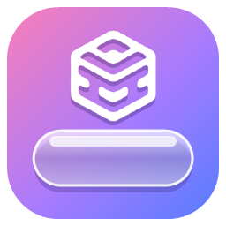

<p align="center"></p>

<h1 align="center">Liquid Dock</h1>

<p align="center">Windows 작업표시줄 대신 쓰는 macOS 스타일 <b>리퀴드 글라스 독</b></p>

<p align="center"><a href="https://github.com/sous1345/liquid-dock">sous1345/liquid-dock</a>(MIT)을 고친 판입니다. 원본과 다른 점과 자세한 동작은 <a href="docs/modifications.md">개조판 안내</a>에 있습니다.</p>

---

## 특징

- **진짜 리퀴드 글라스** – 독 뒤 화면을 실시간으로 받아 GPU 셰이더로 굴절·색수차·흐림·하이라이트를 입힙니다. 배경이 밝으면 글자색도 자동으로 바뀝니다.
- **마우스를 올릴 때만 등장** – 화면 가장자리에 마우스를 대면 스프링 애니메이션으로 나타나고, 벗어나면 숨습니다.
- **맥 같은 확대 효과** – 아이콘 위에서 물결처럼 커집니다.
- **알림은 통통 튀게** – 카톡 등 앱이 알림을 보내면 독은 숨긴 채 해당 아이콘만 화면 끝에서 고개를 내밀고 튑니다(메인 모니터).
- **상하좌우 어디든** – 모니터마다 독이 하나씩 뜹니다. 크기는 Windows 배율이 아니라 화면 크기에 맞춰져서, 해상도가 다른 모니터에서도 화면에서 차지하는 비율이 같습니다.
- **시스템 모니터** – 독 맨 끝 칸에 CPU/GPU 온도가 나오고, 마우스를 올리면 'PC 상태' 패널에 CPU·GPU·RAM·VRAM 사용량과 메모리·드라이브 온도가 나옵니다. 과열 시 한 번만 튀어서 알려 줍니다.
- **배터리** – 노트북에서는 배터리 칸에 잔량과 충전 상태가 나옵니다.
- **Windows 진짜 트레이 연동** – 직접 흉내 낸 게 아니라 Windows 자체 창을 그대로 엽니다.
  - `›` 버튼: 숨겨진 아이콘(알림 영역 오버플로) 창. 디스코드·스팀·블루투스 같은 아이콘이 각자의 원래 메뉴와 함께 나옵니다.
  - 시계: Windows 달력 창 / Wi-Fi: 빠른 설정 / 볼륨: Windows 볼륨 슬라이더
  - (실험) 작업표시줄에 꺼내 둔 트레이 아이콘을 독에 두 줄로 표시
- **시작 버튼** – Windows 작업표시줄의 시작 단추와 똑같이 시작 메뉴를 엽니다.
- **앱 아이콘 클릭은 Windows 작업표시줄 규칙 그대로** – 앞에 떠 있는 창이면 최소화하고, 그 밖에는 창을 다시 띄웁니다. 아이콘에 마우스를 올려 두면 창 미리보기가 나오고, 미리보기에서 창을 닫을 수도 있습니다.
- **우클릭 메뉴** – 볼륨·네트워크·시계·시스템 모니터 칸을 우클릭하면 각각 Windows 작업표시줄과 비슷한 메뉴(소리 설정, 네트워크 설정, 날짜 및 시간 조정, 작업 관리자 등)가 뜹니다.
- **원클릭 버튼** – 설정 창에서 원하는 버튼을 독으로 끌어다 놓아 추가·정렬합니다(작은 버튼은 두 개씩 한 칸에 들어갑니다).
  - 바탕화면 보기, 다크/라이트 전환, OLED 모드(검은 배경·아이콘 숨김, 번인 방지), 화면 꺼짐 방지, 스크린샷,
    알림 튐 끄기, 휴지통(파일을 끌어다 놓기), 최근 다운로드, 오디오 장치 전환, SFF 갤러리 바로가기
- **FluentFlyout 연동** – [FluentFlyout](https://github.com/unchihugo/FluentFlyout)이 실행 중이면 그 작업 표시줄 위젯이 독 안에 들어갑니다.
- **Shift+클릭** 으로 앱을 관리자 권한으로 실행합니다. 관리자 권한으로 실행한 앱의 창은 선택 기능인 관리자 도우미가 다룹니다.
- **기존 작업표시줄 앱 자동 가져오기** – 작업표시줄에 고정해 둔 앱을 순서 그대로 가져옵니다. 스토어(MSIX) 앱(Claude, ChatGPT 등)도 포함입니다. 이후 드래그로 순서 변경·고정/해제가 됩니다.

## 설정

독 끝의 톱니 버튼(또는 빈 곳 우클릭 → 설정)으로 설정 창이 열립니다. 바꾸는 즉시 독에 반영됩니다.

- 위치: 아래 / 왼쪽 / 오른쪽 / 위 (어느 가장자리든)
- 모양: 아이콘 크기·간격, 독 두께, 화면 가장자리와의 거리, 가장자리를 따라 옮기기(슬라이더)
- 유리 질감, 시계 글자, 확대 효과, 나타나는 속도, 숨는 속도
- 자동 숨김 켜기/끄기, 보조 모니터에서만 항상 표시, 독을 불러오는 단축키
- 버튼: 끌어다 놓아 추가·제거·순서 변경, 트레이 아이콘 표시(실험), FluentFlyout 연동
- Windows 시작 시 자동 실행
- 시스템: 관리자 권한 앱 창 제어
- 센서: 온도 읽기(끄기 / HWiNFO Gadget / PawnIO), 'PC 상태'에 보일 항목

## 설치

1. [Releases](../../releases)에서 `LiquidDock-Setup.exe`를 받아 실행합니다.
2. **"Windows의 PC 보호"** 창이 뜨면 → **추가 정보** → **실행**. (코드 서명 인증서가 없는 개인 프로젝트라서 뜨는 경고입니다. 소스는 모두 이 저장소에 있습니다.)
3. 실행하면 바로 설치되고 독이 잠깐 나타납니다. 관리자 권한이 필요 없고 내 계정에만 설치됩니다(`%LOCALAPPDATA%\Programs\LiquidDock`).

- **자동 실행**은 로그온 직후에 바로 시작됩니다(사용자 단위 로그온 작업 + 시작 프로그램 레지스트리 보조, 관리자 권한 불필요).
- 제거: **설정 → 앱 → 설치된 앱 → Liquid Dock → 제거**

### 기본 작업표시줄은 어떻게 되나요?

독이 실행되는 동안 Windows 기본 작업표시줄은 보이지 않게 됩니다(자동 숨김 + 화면에 그리지 않음). 독을 끄거나 제거하면 원래대로 돌아옵니다.

- 독을 종료하면(독 우클릭 → 종료) 작업표시줄이 복원됩니다.
- 문제가 생기면 **Ctrl+Alt+Shift+F12** 로 즉시 종료됩니다.
- 시작 메뉴의 **"Liquid Dock - 작업표시줄 복원"** 을 실행해도 독을 끄고 기본 작업표시줄을 되돌립니다.

## CPU 온도 (선택 기능)

Windows는 CPU 온도를 일반 프로그램에 주지 않기 때문에, CPU 온도는 HWiNFO에서 받아 오거나 드라이버로 직접 읽습니다.
설정 → 센서의 **온도 읽기**에서 고릅니다.

- **HWiNFO Gadget (기본값)** – HWiNFO 센서 설정의 **HWiNFO Gadget** 탭에서 **Enable reporting to Gadget**과 CPU 온도 항목의 **Report value in Gadget**을 체크합니다. 드라이버도 관리자 권한도 필요 없습니다.
- **PawnIO** – [PawnIO](https://pawnio.eu/) 드라이버를 설치하고 PawnIO를 고르면 관리자 확인이 한 번 뜹니다. 그 뒤로는 확인 창 없이 자동으로 켜집니다.

GPU 온도는 NVIDIA만 지원합니다. 온도를 읽지 않아도 사용량 표시를 포함한 나머지 기능은 모두 동작합니다.
일부 게임의 안티치트는 커널 드라이버를 싫어할 수 있습니다. 그런 게임을 하신다면 PawnIO는 쓰지 마세요.
메모리·VRAM 온도와 자세한 설정은 [개조판 안내](docs/modifications.md#cpu-온도-선택-기능)에 있습니다.

## 요구 사항

- Windows 11 권장. Windows 10(2004 이상)은 실험적 지원이며, 개발자가 직접 검증하지 못했습니다.
- DirectX 11 그래픽

## 알려진 한계

- 일반 Windows 11에서 숨겨진 아이콘 창은 Windows가 정한 위치(오른쪽 아래)에 열립니다.
- Windows 10, Intel CPU 온도는 개발자 PC에서 직접 검증하지 못했습니다. 문제가 있으면 Issues에 남겨 주세요.
- 그 밖의 한계와 고치지 않은 알려진 버그는 [개조판 안내](docs/modifications.md#알려진-한계)에 있습니다.

## 개인정보

Liquid Dock은 **인터넷에 아무것도 보내지 않습니다.** 독 뒤 화면 캡처는 GPU 안에서 유리 효과를 그리는 데만 쓰이고 저장되지 않습니다. 설정은 설치 폴더의 `data` 폴더에만 저장됩니다.

## 직접 빌드

Visual Studio 2022 Build Tools(C++ 데스크톱, Windows SDK) 설치 후:

```bat
build.bat
```

`build\LiquidDock-Setup.exe`가 만들어집니다. 테스트는 `tests\run_regressions.bat`으로 돌립니다([테스트 안내](docs/modifications.md#테스트)). 구조:

| 폴더 | 내용 |
|---|---|
| `src/` | 독 본체 (Win32, Direct3D 11, DirectComposition, Windows.Graphics.Capture) |
| `sensors/` | 선택적 관리자 도우미 (CPU 온도, 관리자 권한으로 실행한 앱의 창) |
| `installer/` | 설치/제거 프로그램 |
| `tests/` | 테스트 |
| `docs/` | [개조판 안내](docs/modifications.md) |

## 라이선스

MIT. 포함된 PawnIO 모듈은 LGPL-2.1 — [THIRD_PARTY_NOTICES.txt](THIRD_PARTY_NOTICES.txt) 참고.
